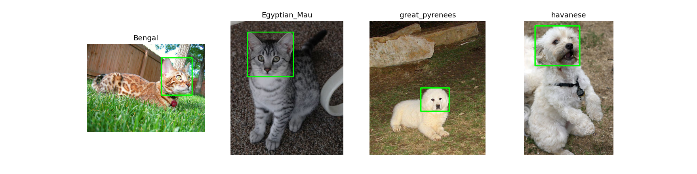

# Лабораторная работа 1. Среда, репозиторий и первый взгляд на данные

1. **Задача**. Первичный анализ структуры датасета, проверка разметки и изучение метаданных изображений.
2. **Как запустить**. Запускала в Google Colab, перед нажатием «Run All» в ячейке параметров указала `VARIANT = 1`.
3. **Данные**. Вариант 1. Породы из файла `variant.json`: `Bengal`, `Egyptian_Mau`, `great_pyrenees`, `havanese`.
4. **Результаты**. 
Главные показатели из файла `summary.csv`:

| Метрика | Значение |
| --- | --- |
| Всего файлов (`n_files`) | 795 |
| Количество пород (`n_breeds`) | 4 |
| Коты / Собаки | 395 / 400 |
| Разрешение (ширина: мин/мед/макс) | 150 / 500 / 3264 |
| Разрешение (высота: мин/мед/макс) | 112 / 375 / 2606 |

5. **Выводы**.
- Найдено 3 файла не в RGB из 795: 2 в режиме RGBA и 1 в градациях серого L; без проверки через Pillow они бы читались некорректно и могли вызвать ошибку при обучении.
- У изображений огромный разброс размеров (высота от 112 до 2606 пикселей), поэтому грубое применение `cv2.resize(img, (224, 224))` сильно исказит пропорции самых вытянутых кадров.
- Разметка ограничивающих рамок присутствует для 390 изображений из 795, что позволяет использовать их для задач детекции.
