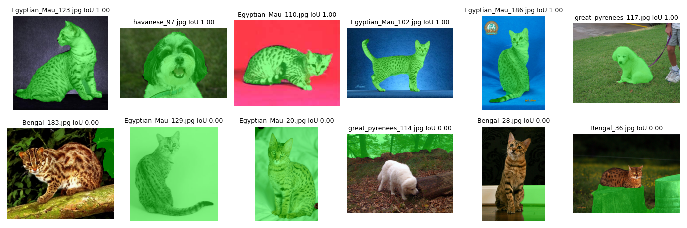

# Лабораторная N2: Классическая обработка: гистограммы, фильтры, пороги, морфология, контуры
 
**Вариант:** 1

## 1. Задача

Выделить животное по каналу цвета S и морфологическим операциям, а затем сравнить полученную маску с эталонной через метрику IoU и признаки формы.

## 2. Как запустить

Запускалось в Google Colab. Перед выполнением скрипта необходимо открыть `solution.ipynb`, в ячейке параметров установить номер варианта `VARIANT = 1` и запустить все ячейки (Run All).

## 3. Данные

Вариант 1. Породы в датасете: Bengal, Egyptian_Mau, great_pyrenees, havanese. Битых файлов и дубликатов не обнаружено.

## 4. Результаты

Основные метрики качества сегментации и признаки формы по породам:

| Порода | IoU | Доля площади (area_frac) | Вытянутость (elongation) | Солидность (solidity) |
| :--- | --: | --: | --: | --: |
| Bengal | 0.23 | 0.70 | 1.48 | 0.80 |
| Egyptian_Mau | 0.47 | 0.70 | 1.39 | 0.83 |
| great_pyrenees | 0.50 | 0.69 | 1.40 | 0.84 |
| havanese | 0.55 | 0.62 | 1.41 | 0.81 |

## 5. Выводы

- На породе havanese метод показал наибольшее среднее качество сегментации (IoU 0.55), в то время как на Bengal качество оказалось минимальным (IoU 0.23); это связано со сложностью выделения пятнистого окраса бенгальских кошек по цветовому каналу S.
- Доля площади объектов (area_frac) по всем четырем породам держится на стабильном уровне от 0.62 (havanese) до 0.70 (Bengal и Egyptian_Mau), что говорит о сопоставимом масштабе животных на кадрах.
- Порог по солидности (solidity) у всех пород зафиксирован в узком диапазоне 0.80–0.84 (максимум 0.84 у great_pyrenees), что подтверждает высокую монолитность и схожую форму силуэтов масок без сильных разрывов.
- Вытянутость (elongation) оказалась практически одинаковой для всех классов и составила от 1.39 (Egyptian_Mau) до 1.48 (Bengal), отражая схожие пропорции тел животных в датасете.
