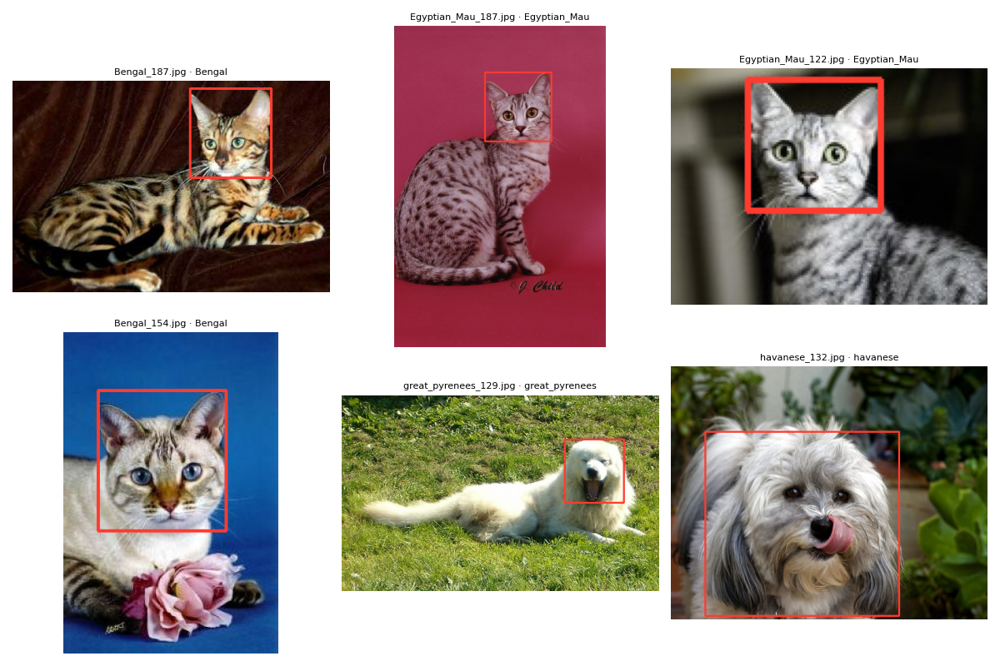
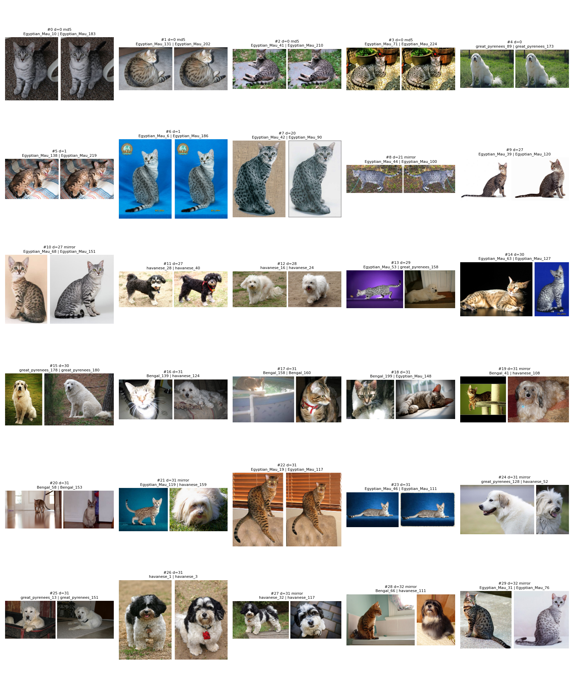
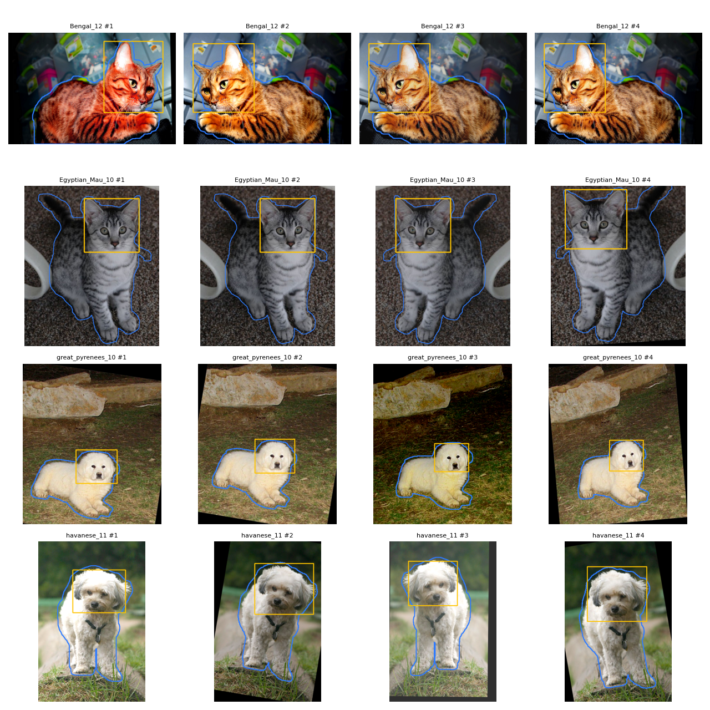
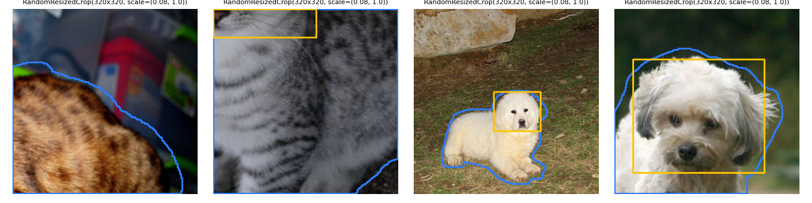

# Лабораторная 3: Данные: разметка, дубликаты, честное разбиение, аугментации

**Вариант:** 1

## 1. Задача

Провести аудит датасета изображений животных и разметки (масок trimap и рамок голов), конвертировать данные в форматы COCO и YOLO, выявить дубликаты и серии кадров и выполнить групповое стратифицированное разбиение без утечек. Также требуется собрать рабочие аугментации и показать, какая аугментация ломает разметку.

## 2. Как запустить

Работа запускалась в Google Colab на базе стартового ноутбука. Перед запуском задаётся VARIANT = 1, после чего выполняется Run All сверху вниз до проверки всех 11 файлов в results/, а скачанный ноутбук сохраняется как solution.ipynb с сохранёнными выводами.

```bash
pip install -r requirements.txt
# откройте solution.ipynb, впишите VARIANT = 1 и выполните Run All
```

## 3. Данные

- Вариант: 1, 795 изображений, классы: Bengal, Egyptian_Mau, great_pyrenees, havanese.
- Граница trimap (BORDER_AS): выбрано значение "animal" (пограничный класс 3 отнесён к объекту), чтобы не терять контуры шерсти и ушей на границе с фоном.
- Очистка и отбор: битые файлы и исходные снимки в репозиторий не включались; при проверке разметки зафиксированы особенности/замечания без удаления валидных данных датасета.

## 4. Результаты

| Что | Значение |
| --- | --: |
| Всего изображений в варианте | 795 |
| Замечаний при проверке разметки (format_check) | 9 (пустые trimap, отсутствие рамок, многообъектные кадры, ч/б, RGBA/PNG) |
| Максимальное расхождение рамок VOC -> YOLO -> VOC | 0.001 px |
| Медиана IoU маски после перевода в полигон | 0.9958 |
| Минимум IoU маски после перевода в полигон | 0.9585 |
| Размечено пар как same / series (из топ-30 по хэшу) | 6 same / 9 series |
| Групп из 2+ фото (после объединения same и series) | 15 (30 снимков) |
| Размеры выборок (train / val / test) | 570 / 112 / 113 |
| Разорванных групп при случайном разбиении (в среднем) | 7.02 (и 3.00 групп одновременно в train и test) |
| Доля рамок с box_area_frac < 0.05 (менее 5% кадра) | 0.1744 (17.44%) |
| Поломка при RandomResizedCrop(320x320, scale=(0.08, 1.0)) | 0.1207 (голова вне кадра) / 0.3798 (< 0.5 головы) |






## 5. Выводы

- Особенности разметки и полигонов: проверка формата выявила 9 замечаний, а перевод масок в полигоны даёт медиану IoU 0.9958 и минимум 0.9585 (расхождение рамок VOC -> YOLO -> VOC всего 0.001 px) — такой высокий IoU показывает, что аппроксимация многоугольником почти не искажает контуры, а небольшие просадки на минимуме связаны с тонкими деталями краёв.
- Дубликаты, серии и размер рамок: среди первых 30 пар кандидатов по хэшу подтвердились 6 пар same и 9 пар series (остальные 15 — ложные срабатывания перцептивного хэша из-за похожего фона или позы), а 17.44% рамок занимают менее 5% площади кадра, что повышает риск потери мелких объектов при грубом масштабировании.
- Утечки при случайном сплите: случайное разбиение в среднем рвёт 7.02 группы и в 3.00 случаях отправляет связанные кадры одновременно в train и test, из-за чего метрики на тесте оказываются завышенными и не отражают обобщающую способность на новых снимках.
- Баланс выборок и аугментации: групповое стратифицированное разбиение дало 0 разорванных групп при размерах 570 / 112 / 113 и близких долях пород (~23.2–26.8%), тогда как агрессивный RandomResizedCrop(320x320, scale=(0.08, 1.0)) в 12.07% случаев выносит голову за кадр и в 37.98% оставляет меньше половины головы — для обучения оставлены мягкие геометрические и цветовые преобразования (HorizontalFlip, умеренный Affine, RandomBrightnessContrast, ColorJitter).

Группой считается связная компонента фотографий, объединённых по меткам same (дубликаты) и series (серии близких кадров), чтобы одинаковые или почти идентичные объекты не попадали в разные сплиты. Для разбиения использован групповой стратифицированный подход (StratifiedGroupKFold), поскольку он сохраняет баланс классов по породам и при этом запрещает разделение одной группы между train, val и test.
